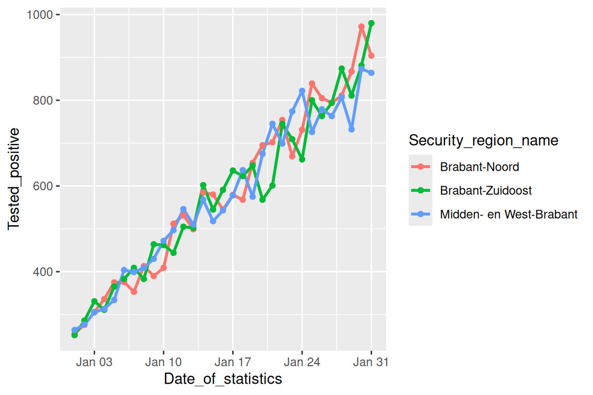
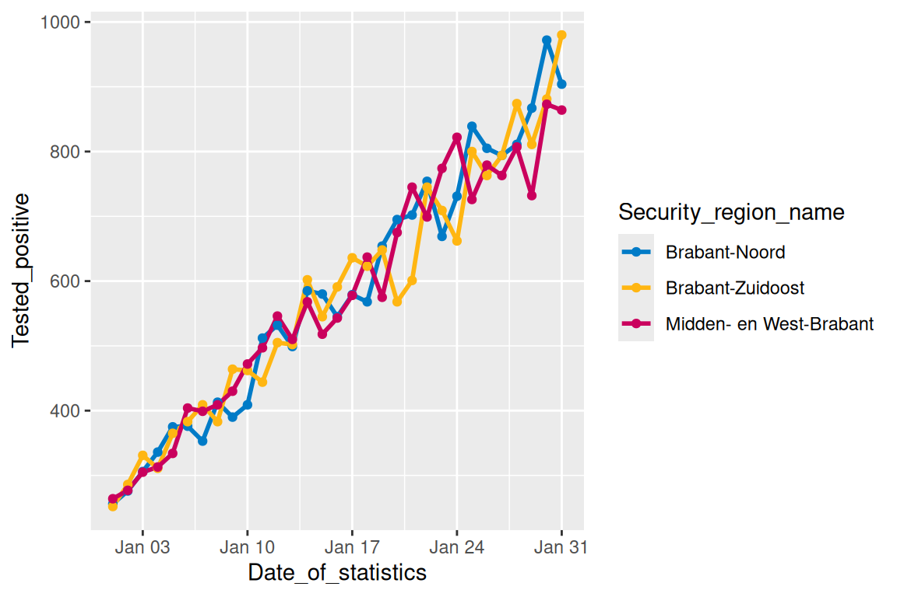
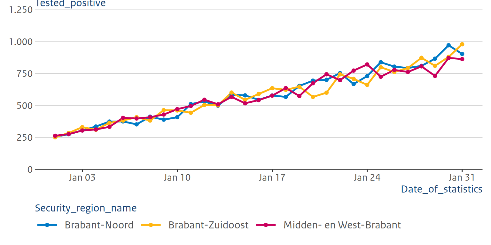
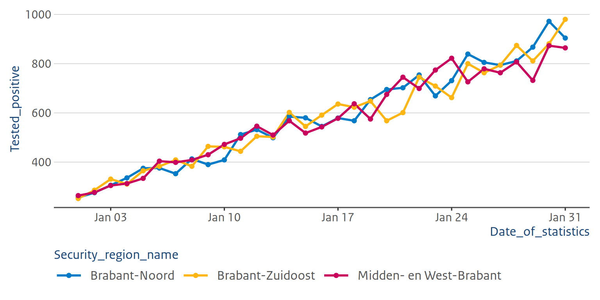

# Getting Started with ROvis

The visualization functions in ROvis make it easy to apply RIVM colors
when creating plots R. In addition, ROvis provides standardized RIVM
themes for graphs (`ggplot2`), tables (`gt`) and HTML reports created
with `rmarkdown`. These color palettes and themes were designed to make
reporting more consistent, readable, and aligned with the RIVM visual
identity.

In our package, we follow the
[rijkshuisstijl](https://www.rijkshuisstijl.nl/modules/folder/brandguide/default/grouplist.aspx?ItemId=6739)
wherever possible.

> **Important**
>
> In this vignette, the examples specifically follow the style
> guidelines of the National Institue for Public Health and the
> Envrionment (RIVM).

## Loading data

First, we need to load the required packages.

``` r

library(tidyverse)
library(ROvis.utils)
library(ROvis.ggplot2) # nolint: missing_package_linter.
```

Second, we generate simulated data that mimics the structure of COVID-19
test data. We will use data for January 2022 for example graphs.

``` r

# Set seed for reproducibility
set.seed(123)

# Generate data for multiple regions used in the examples
dat_test_cov <- expand_grid(
  Date_of_statistics = seq(as_date("2022-01-01"), as_date("2022-01-31"), by = "day"),
  Security_region_name = c(
    "Brabant-Noord", "Brabant-Zuidoost", "Midden- en West-Brabant",
    "Noord- en Oost-Gelderland", "Gelderland-Midden", "Gelderland-Zuid", "Onbekend"
  )
) |>
  mutate(
    # Calculate day number (1-31) for upward trend
    day_num = as.numeric(Date_of_statistics - as_date("2022-01-01")) + 1,
    # Generate test numbers with slight variation
    Tested_with_result = as.integer(round(rnorm(n(), mean = 1800, sd = 50))),
    # Positive tests with steep upward trend: start at ~15% and increase to ~50%
    positive_rate = 0.15 + (day_num - 1) * (0.50 - 0.15) / 30,
    Tested_positive = as.integer(round(
      Tested_with_result * positive_rate * rnorm(n(), mean = 1, sd = 0.05)
    ))
  ) |>
  select(Date_of_statistics, Security_region_name, Tested_positive) |>
  mutate(Security_region_name = factor(Security_region_name)) |>
  as_tibble()
```

The first 5 rows look like this:

``` r

dat_test_cov |>
  head(5)
## # A tibble: 5 × 3
##   Date_of_statistics Security_region_name      Tested_positive
##   <date>             <fct>                               <int>
## 1 2022-01-01         Brabant-Noord                         256
## 2 2022-01-01         Brabant-Zuidoost                      252
## 3 2022-01-01         Midden- en West-Brabant               264
## 4 2022-01-01         Noord- en Oost-Gelderland             263
## 5 2022-01-01         Gelderland-Midden                     279
```

## Colors

### Exploring colors

To explore the RIVM color palettes included in ROvis, run
[`ro_show_colors()`](https://rivm-syso.github.io/ROvis.utils/reference/ro_show_colors.html)
in the R Console. This will open a visual display of the color palettes
in the Viewer pane, where you can also hover over each color to see its
corresponding hex code.

By default all 18 RIVM colors are shown. These standardized colors are
recommended for use in visualizations to maintain consistency across
reports. Some of these colors also have lighter (’\_tint90’) and darker
(’\_tint110’) variations. These shades are helpful when you need to use
several colors together, as they maintain similar contrast levels.

If you need multiple colors, you can use one of the predefined color
palettes. For standardized reporting, we recommend using the built-in
categorical and gender palettes instead of creating custom palettes. You
can see a demonstration of all available palettes below:

#### Full

``` r

ro_show_colors()
```

#### Categorical

``` r

ro_show_colors(palette_name = "categorical")
```

#### Gender (conventional)

``` r

ro_show_colors(palette_name = "gender_con")
```

#### Gender (unconventional)

``` r

ro_show_colors(palette_name = "gender_unc")
```

#### Greys

``` r

ro_show_colors(palette_name = "greys")
```

### How to use colors in `ggplot` functions

To demonstrate the use of colors, we select the security regions in
“Brabant” using `filter`. We start by creating a plot without specifying
colors. Thus, the resulting plot shows standard colors of `ggplot`.

``` r

fig_brab <- dat_test_cov |>
  filter(
    Security_region_name %in% c("Midden- en West-Brabant", "Brabant-Noord", "Brabant-Zuidoost")
  ) |>
  ggplot(aes(
    x = Date_of_statistics,
    y = Tested_positive,
    color = Security_region_name
  )) +
  geom_line(linewidth = 1) +
  geom_point()
fig_brab
```



Now, we want to apply the RIVM colors by using
[`ROvis.utils::ro_color()`](https://rivm-syso.github.io/ROvis.utils/reference/ro_color.html)
as part of
[`scale_colour_manual()`](https://ggplot2.tidyverse.org/reference/scale_manual.html).
For categorical data, you should use the standard RIVM categorical color
palette. The recommended order of the palette should be followed,
starting with ‘hemelblauw’ for your first category.

``` r

fig_brab +
  scale_colour_manual(
    values = c(
      "Brabant-Noord" = ro_color("hemelblauw"),
      "Brabant-Zuidoost" = ro_color("donkergeel"),
      "Midden- en West-Brabant" = ro_color("robijnrood")
    )
  )
```


Alternatively, we can use the
[`ROvis.utils::ro_color_categorical()`](https://rivm-syso.github.io/ROvis.utils/reference/ro_color_categorical.html)
function in
[`scale_colour_manual()`](https://ggplot2.tidyverse.org/reference/scale_manual.html).
This function returns the hex codes of the categorical color palette in
the correct order, which makes it very easy to use.

``` r

fig_brab +
  scale_color_manual(values = c(ROvis.utils::ro_color_categorical()))
```



If you want to learn more about using color palettes for ordinal and
continuous data, go to the [Working with color palettes
vignette](https://rivm-syso.github.io/ROvis.utils/articles/color-palettes.html).

## Themes and style

### Apply the RO style to your `ggplot2` graphs the easy way: `ro_gg_plot()`

Above figures are not completely ready to publish yet. Luckily, there is
a shortcut for getting your graphs into full RO style:
[`ro_gg_plot()`](https://rivm-syso.github.io/ROvis.ggplot2/dev/reference/ro_gg_plot.md).
This function applies the RO theme, formats your numbers with thousands
separators, makes sure your axis starts at zero where that makes sense,
moves your y-axis title to the right spot, and even fixes up bar spacing
and tick marks if your plot has bars. It also drops legend titles
automatically, since RO style never shows them.

Just build your plot the way you normally would, save it to an object,
and run
[`ro_gg_plot()`](https://rivm-syso.github.io/ROvis.ggplot2/dev/reference/ro_gg_plot.md)
on it as the very last step:

``` r

fig_brab_ro <- fig_brab +
  scale_color_manual(values = c(ROvis.utils::ro_color_categorical()))

ro_gg_plot(fig_brab_ro)
## Keep in mind that when using ro_gg_theme, you need to take additional coding steps to fully comply
##     with the RIVM style. For more information, see the ROvis documentation website:
##     https://rivm-syso.github.io/ROvis
## This message is displayed once per session.
## Warning in scale_x_date(): A <numeric> value was passed to a Date scale.
## ℹ The value was converted to a <Date> object.
## A <numeric> value was passed to a Date scale.
## ℹ The value was converted to a <Date> object.
```



### Just the theme: `ro_gg_theme()`

Sometimes you only want the look and feel (colors, fonts, background,
and so on) without the other automatic fixes. In that case, you can use
the lower-level
[`ro_gg_theme()`](https://rivm-syso.github.io/ROvis.ggplot2/dev/reference/ro_gg_theme.md).
It is actually the theme that
[`ro_gg_plot()`](https://rivm-syso.github.io/ROvis.ggplot2/dev/reference/ro_gg_plot.md)
uses behind the scenes.

You can add it with `+`, the same way you would add any other `ggplot`
theme. **Version 1.0** is the first official version published, and
`ro_gg_theme(version = "1.0")` gives you that version. For the full list
of what this theme does, run `?ro_gg_theme()` in your console.

``` r

fig_brab +
  scale_color_manual(values = c(ROvis.utils::ro_color_categorical())) +
  ro_gg_theme(version = "1.0")
```



Keep in mind that if you use
[`ro_gg_theme()`](https://rivm-syso.github.io/ROvis.ggplot2/dev/reference/ro_gg_theme.md)
on its own, you will need to take some extra coding steps yourself to
fully comply with RO style, things like number formatting and axis
positioning. That is exactly why
[`ro_gg_plot()`](https://rivm-syso.github.io/ROvis.ggplot2/dev/reference/ro_gg_plot.md)
exists, to save you that work.

Want to see everything
[`ro_gg_plot()`](https://rivm-syso.github.io/ROvis.ggplot2/dev/reference/ro_gg_plot.md)
can do, across different chart types? Check out the [ggplot2 in RO style
vignette](https://rivm-syso.github.io/ROvis.ggplot2/dev/articles/ggplot2-in-ro-style.md).
